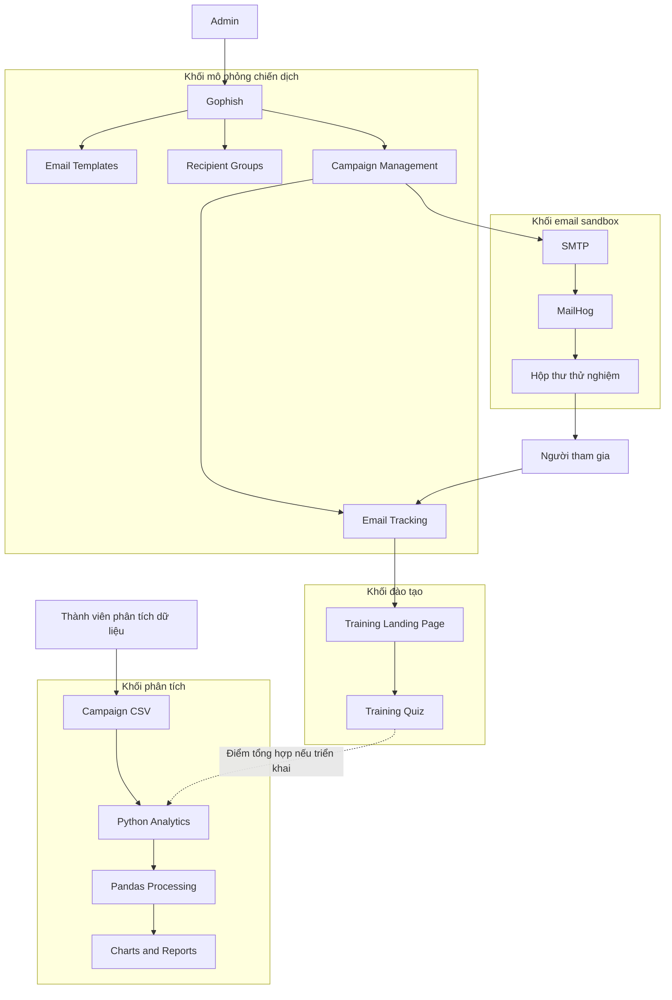
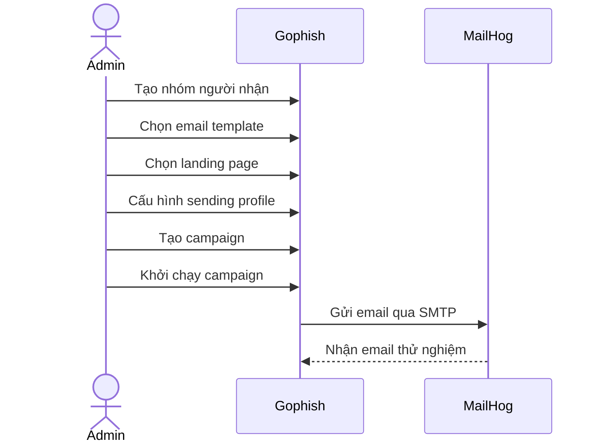
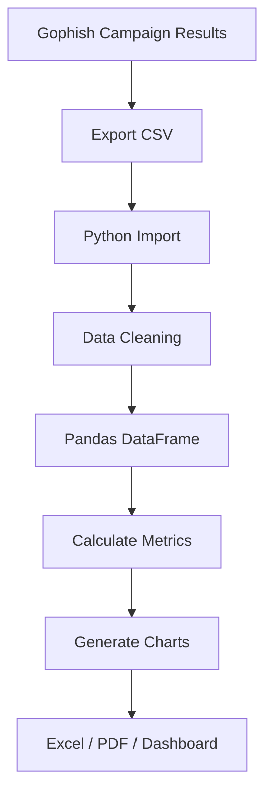

# PHISHLAB
# TÀI LIỆU THIẾT KẾ KIẾN TRÚC HỆ THỐNG
**Tên đề tài:** PhishLab – Hệ thống mô phỏng và đánh giá nhận thức người dùng trước các cuộc tấn công Phishing
**Tài liệu:** System Architecture
**Phiên bản:** 1.0
**Phụ trách:** Member 01 – Project Lead / Analyst
---
## 1. Giới thiệu
### 1.1. Mục đích
Tài liệu mô tả kiến trúc tổng thể của hệ thống PhishLab, bao gồm các thành phần công nghệ, vai trò của từng thành phần, cách các thành phần kết nối với nhau và luồng dữ liệu trong quá trình mô phỏng phishing.
Tài liệu là cơ sở để các thành viên triển khai từng module và tích hợp thành một hệ thống thống nhất.
### 1.2. Tổng quan hệ thống
PhishLab là hệ thống mô phỏng và đánh giá nhận thức người dùng trước các cuộc tấn công Phishing.
Hệ thống sử dụng Gophish làm công cụ chính để quản lý chiến dịch và tracking; MailHog làm SMTP sandbox; HTML/CSS/JavaScript để xây dựng trang đào tạo và quiz; Python để xử lý dữ liệu và tạo báo cáo.
### 1.3. Mục tiêu kiến trúc
- Tận dụng các chức năng có sẵn của Gophish thay vì phát triển lại từ đầu.
- Tách biệt chức năng mô phỏng email, đào tạo và phân tích dữ liệu.
- Đảm bảo email thử nghiệm được xử lý trong môi trường lab.
- Không thu thập thông tin đăng nhập thật.
- Cho phép xuất dữ liệu chiến dịch để xử lý và báo cáo.
- Hỗ trợ triển khai MVP trước, sau đó mới mở rộng dashboard web hoặc tích hợp API tự động.
## 2. Nguyên tắc thiết kế
### 2.1. Tận dụng công cụ có sẵn
Gophish đảm nhiệm các chức năng:
- Quản lý email template.
- Quản lý nhóm người nhận.
- Quản lý chiến dịch.
- Quản lý landing page.
- Theo dõi sự kiện gửi, mở và nhấp.
- Xuất kết quả chiến dịch.
Nhóm không cần xây dựng lại các chức năng quản lý campaign và tracking này.
### 2.2. Phân chia module
Hệ thống được chia thành các nhóm thành phần:
1. Simulation Management: Quản lý chiến dịch mô phỏng bằng Gophish.
2. Email Sandbox: Nhận email thử nghiệm bằng MailHog.
3. Training Portal: Hiển thị nội dung đào tạo và quiz.
4. Analytics: Xử lý dữ liệu bằng Python.
5. Dashboard and Report: Trực quan hóa và xuất kết quả.
### 2.3. Bảo mật theo phạm vi lab
- Các máy chủ chỉ hoạt động trong mạng lab hoặc mạng nội bộ được phê duyệt.
- Không mở giao diện quản trị Gophish ra Internet.
- Sử dụng dữ liệu người nhận giả lập trong demo.
- Không lưu mật khẩu, OTP, cookie hoặc session token.
- Gophish phải đặt Capture Submitted Data = OFF và Capture Passwords = OFF.
- Trang đào tạo không có biểu mẫu đăng nhập hoặc trường nhập thông tin xác thực.
- Không triển khai credential harvester hoặc phishing reverse proxy.
## 3. Kiến trúc tổng thể
### 3.1. Sơ đồ kiến trúc

**Giải thích:**
- Admin quản lý chiến dịch thông qua Gophish.
- Gophish gửi email qua SMTP đến MailHog.
- Người tham gia xem email trong hộp thư thử nghiệm.
- Khi người tham gia nhấp liên kết, Gophish ghi nhận sự kiện tracking và chuyển đến trang đào tạo.
- Người tham gia đọc nội dung đào tạo và làm quiz nếu chức năng này được triển khai.
- Kết quả chiến dịch được xuất thành CSV để Python xử lý.
- Dữ liệu sau xử lý được dùng để tạo biểu đồ, dashboard và báo cáo.
- Nếu có quiz, điểm tổng hợp có thể được bổ sung vào dữ liệu phân tích theo cách không gắn câu trả lời với danh tính cá nhân.
### 3.2. Các khối kiến trúc
| Khối | Thành phần | Chức năng |
|---|---|---|
| Simulation Management | Gophish | Quản lý template, nhóm người nhận, campaign và tracking |
| Email Sandbox | MailHog | Nhận và hiển thị email thử nghiệm |
| Training | HTML/CSS/JavaScript | Trang đào tạo và quiz |
| Analytics | Python, Pandas | Làm sạch, tổng hợp và tính toán chỉ số |
| Visualization | Excel, Matplotlib hoặc Dashboard | Hiển thị kết quả và báo cáo |
## 4. Thiết kế chi tiết các thành phần
### 4.1. Gophish
**Vai trò:** Thành phần chính quản lý chiến dịch mô phỏng phishing.
**Chức năng sử dụng:**
- Quản lý email template.
- Quản lý nhóm người nhận.
- Tạo và cấu hình campaign.
- Cấu hình sending profile.
- Cấu hình landing page.
- Theo dõi sự kiện gửi email, mở email và nhấp liên kết.
- Xuất kết quả chiến dịch.
**Thành phần phụ trách:** Member 02.
### 4.2. MailHog
**Vai trò:** SMTP sandbox dùng để nhận email thử nghiệm.
**Chức năng sử dụng:**
- Nhận email từ Gophish qua SMTP.
- Hiển thị email trong giao diện web.
- Hỗ trợ kiểm tra nội dung và định dạng email.
- Giữ email thử nghiệm trong môi trường lab thay vì chuyển đến hộp thư bên ngoài.
**Cấu hình demo đề xuất:**
| Thành phần | Địa chỉ |
|---|---|
| SMTP | 127.0.0.1:1025 |
| Web UI | 127.0.0.1:8025 |
Các địa chỉ trên là cấu hình demo đề xuất. Cần đối chiếu với cấu hình và log thực tế khi triển khai.
**Thành phần phụ trách:** Member 02.
### 4.3. Email Templates
**Vai trò:** Cung cấp các kịch bản email mô phỏng để sử dụng trong chiến dịch.
**Số lượng tối thiểu:** 3 mẫu.
**Các kịch bản:**
1. Thông báo từ bộ phận IT.
2. Thông báo giao hàng.
3. Thông báo từ bộ phận nhân sự.
Các mẫu sử dụng tổ chức và tên miền giả lập trong lab.
**Thành phần phụ trách:** Member 03.
### 4.4. Training Landing Page
**Vai trò:** Hướng dẫn người tham gia nhận diện email phishing sau khi nhấp vào liên kết mô phỏng.
**Nội dung:**
- Thông báo đây là hoạt động đào tạo mô phỏng.
- Giải thích các dấu hiệu nhận diện email phishing.
- Hướng dẫn xác minh người gửi.
- Khuyến nghị cách xử lý email đáng ngờ.
**Yêu cầu bảo mật:**
- Không hiển thị biểu mẫu đăng nhập.
- Không có trường nhập mật khẩu hoặc OTP.
- Không thu thập thông tin xác thực.
- Nội dung đào tạo được hiển thị trực tiếp sau khi truy cập.
**Thành phần phụ trách:** Member 03.
### 4.5. Training Quiz
**Vai trò:** Đánh giá khả năng nhận diện phishing sau đào tạo.
**Công nghệ:** HTML, CSS và JavaScript.
**Chức năng dự kiến:**
- Hiển thị câu hỏi.
- Cho phép người tham gia chọn câu trả lời.
- Tính điểm.
- Hiển thị kết quả.
**Dữ liệu:** Chỉ lưu điểm số tổng hợp; không lưu câu trả lời gắn với danh tính hoặc email cá nhân.
**Thành phần phụ trách:** Member 03 và Member 04.
Đây là chức năng nên có, không phải điều kiện bắt buộc của MVP theo mức ưu tiên trong kế hoạch.
### 4.6. Python Analytics
**Vai trò:** Xử lý dữ liệu chiến dịch để tạo báo cáo.
**Công nghệ:**
- Python.
- Pandas.
- Matplotlib.
**Quy trình xử lý dự kiến:**
1. Đọc dữ liệu CSV xuất từ Gophish.
2. Kiểm tra cấu trúc dữ liệu.
3. Làm sạch dữ liệu.
4. Tổng hợp số lượng email gửi thành công, mở và nhấp.
5. Tính toán các tỷ lệ.
6. Tổng hợp điểm quiz nếu có dữ liệu.
7. Tạo dữ liệu đầu ra cho dashboard và báo cáo.
**Thành phần phụ trách:** Member 04.
### 4.7. Dashboard và báo cáo
**Vai trò:** Trình bày kết quả chiến dịch dưới dạng dễ quan sát.
**Nội dung đề xuất:**
- Campaign Overview.
- Interaction Analysis.
- Scenario Comparison.
- Training Effectiveness.
**Công nghệ MVP:** Excel hoặc biểu đồ Python.
**Hướng mở rộng:** Dashboard web và tích hợp Gophish API sau khi MVP hoạt động ổn định.
**Thành phần phụ trách:** Member 04.
## 5. Luồng hoạt động của hệ thống
### 5.1. Luồng khởi tạo chiến dịch

### 5.2. Luồng người tham gia
```mermaid
sequenceDiagram
    actor Participant as Người tham gia
    participant MailHog
    participant Gophish
    participant Training as Training Portal

    Participant->>MailHog: Mở hộp thư thử nghiệm
    MailHog-->>Participant: Hiển thị email
    Participant->>Gophish: Nhấp liên kết mô phỏng
    Gophish->>Gophish: Ghi nhận sự kiện nhấp
    Gophish-->>Participant: Chuyển đến trang đào tạo
    Participant->>Training: Truy cập nội dung
    Training-->>Participant: Hiển thị hướng dẫn nhận diện
    opt Có triển khai quiz
        Participant->>Training: Hoàn thành bài kiểm tra
        Training-->>Participant: Hiển thị điểm tổng hợp
    end
```
### 5.3. Luồng xử lý dữ liệu và báo cáo

Trong MVP, sử dụng CSV để chuyển dữ liệu trước. Sau khi luồng xử lý ổn định, nhóm mới cân nhắc lấy dữ liệu tự động thông qua API.
## 6. Thiết kế dữ liệu phân tích
### 6.1. Các trường dữ liệu
| Trường | Ý nghĩa |
|---|---|
| Campaign ID | Mã chiến dịch |
| Recipient Code | Mã người tham gia đã giả danh |
| Email Sent | Trạng thái gửi email |
| Email Opened | Trạng thái mở email |
| Link Clicked | Trạng thái nhấp liên kết |
| Training Completed | Trạng thái hoàn thành đào tạo |
| Quiz Score | Điểm bài kiểm tra |
| Reported | Trạng thái email được báo cáo qua kênh báo cáo |
Không đưa thông tin định danh cá nhân không cần thiết vào dashboard phân tích.
Đối với Reported, cần xác định kênh báo cáo nội bộ và cách xác nhận sự kiện. Không mặc định Gophish tự động nhận biết tất cả thao tác báo cáo email.
### 6.2. Chỉ số thống kê
| Chỉ số | Công thức |
|---|---|
| Send Rate | Số email gửi thành công / Tổng người nhận × 100% |
| Open Rate | Số lượt mở / Số email gửi thành công × 100% |
| Click Rate | Số người nhấp liên kết / Số email gửi thành công × 100% |
| Report Rate | Số email được báo cáo / Số email gửi thành công × 100% |
| Training Completion | Số người hoàn thành đào tạo / Số người được đưa đến trang đào tạo × 100% |
**Lưu ý:** Open Rate chỉ mang tính tham khảo vì email client có thể chặn hoặc tự động tải ảnh tracking. Trạng thái gửi thành công cũng không đồng nghĩa email chắc chắn đã vào Inbox.
## 7. Cấu trúc repository liên quan
```text
phishlab/
│
├── docs/
│   ├── requirements.md
│   ├── use-case.md
│   ├── architecture.md
│   ├── plan-review.md
│   ├── report-sections.md
│   ├── test-cases.md
│   ├── deployment-guide.md
│   └── final-report.md
│
├── gophish/
│   ├── config/
│   ├── email_templates/
│   ├── landing_pages/
│   └── sample_groups/
│
├── training_portal/
│   ├── css/
│   ├── js/
│   └── assets/
│
├── analytics/
│   ├── data/
│   ├── notebooks/
│   ├── scripts/
│   └── output/
│
├── dashboard/
└── tests/
```
Tên file và thư mục trong sơ đồ thể hiện cấu trúc repository dự kiến của dự án. Không phải tất cả file đều thuộc trách nhiệm triển khai của Member 01.
## 8. Thiết kế triển khai môi trường lab
### 8.1. Cấu hình demo đề xuất
| Thành phần | Địa chỉ đề xuất |
|---|---|
| Gophish Admin | 127.0.0.1:3333 |
| Gophish Landing | 127.0.0.1:8080 |
| MailHog SMTP | 127.0.0.1:1025 |
| MailHog Web | 127.0.0.1:8025 |
Các địa chỉ trên là cấu hình demo đề xuất, không phải kết quả xác nhận hệ thống đã triển khai.
### 8.2. Nguyên tắc triển khai
- Gophish Admin chỉ bind trên localhost hoặc địa chỉ quản trị nội bộ được kiểm soát.
- MailHog chỉ sử dụng cho mục đích thử nghiệm.
- Không mở SMTP sandbox ra Internet công cộng.
- Nếu sử dụng nhiều máy trong mạng lab, phải dùng địa chỉ nội bộ có thể truy cập giữa các máy.
- Không sử dụng `127.0.0.1` làm địa chỉ truy cập từ máy khác, vì địa chỉ này luôn trỏ đến chính máy đang truy cập.
- Kiểm tra firewall và giới hạn cổng mạng theo môi trường lab thực tế.
## 9. Kế hoạch tích hợp module
| Giai đoạn | Thành phần | Công việc tích hợp | Thành viên phối hợp |
|---|---|---|---|
| 1 | Gophish và MailHog | Kiểm tra gửi email vào SMTP sandbox | Member 01, 02 |
| 2 | Email template | Kiểm tra nội dung email trên MailHog | Member 01, 02, 03 |
| 3 | Landing page | Kiểm tra chuyển từ email đến trang đào tạo | Member 01, 02, 03 |
| 4 | Quiz | Kiểm tra tính điểm và dữ liệu tổng hợp | Member 01, 03, 04 |
| 5 | Analytics | Kiểm tra nhập CSV và tổng hợp dữ liệu | Member 01, 02, 04 |
| 6 | Dashboard | Đối chiếu kết quả hiển thị với dữ liệu nguồn | Member 01, 04 |
| 7 | Tổng thể | Chạy luồng demo và kiểm thử tích hợp | Cả nhóm |
### 9.1. Nguyên tắc tích hợp
- Mỗi thành viên hoàn thành chức năng theo phạm vi đã phân công.
- Trước khi tích hợp, cần kiểm tra cấu trúc file và cách sử dụng module.
- Các thay đổi được đưa lên branch riêng và tạo Pull Request.
- Member 01 điều phối việc review và tích hợp.
- Chỉ merge khi các thay đổi đã được kiểm tra và không làm ảnh hưởng chức năng hiện có.
- Lỗi phát sinh trong quá trình tích hợp phải được ghi nhận và giao cho thành viên phụ trách xử lý.
## 10. Khả năng mở rộng
Sau khi MVP hoạt động ổn định, nhóm có thể xem xét:
- Dashboard web tự động.
- Tích hợp Gophish API.
- Tự động hóa quá trình nhập dữ liệu chiến dịch.
- So sánh kết quả trước và sau đào tạo.
- Đánh giá hiệu quả giữa các kịch bản email.
Đây là các hướng mở rộng, không phải điều kiện bắt buộc để hoàn thành MVP.
## 11. Kết luận
Kiến trúc PhishLab sử dụng Gophish làm thành phần trung tâm cho hoạt động quản lý và theo dõi chiến dịch; MailHog đảm nhiệm vai trò SMTP sandbox; Training Portal cung cấp nội dung đào tạo; Python Analytics xử lý dữ liệu và tạo báo cáo.
Cách phân chia này giúp nhóm tận dụng công cụ có sẵn, tập trung phát triển các thành phần thể hiện giá trị của đề tài và duy trì phạm vi triển khai phù hợp với thời gian thực hiện.
**Lưu ý:** Tài liệu này mô tả kiến trúc thiết kế mục tiêu. Các trạng thái triển khai thực tế và kết quả kiểm thử sẽ được cập nhật sau khi các thành viên hoàn thành module và nhóm tích hợp hệ thống.
---
**Phụ trách:** Member 01 – Project Lead / Analyst