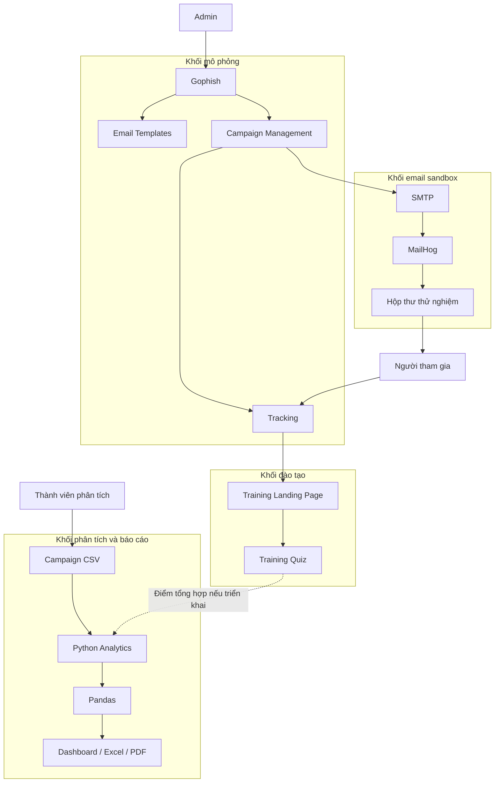

# PHISHLAB
# NỘI DUNG BÁO CÁO DO MEMBER 01 PHỤ TRÁCH
**Tên đề tài:** PhishLab – Hệ thống mô phỏng và đánh giá nhận thức người dùng trước các cuộc tấn công Phishing
**Phụ trách:** Member 01 – Project Lead / Analyst
**Mục đích:** Cung cấp nội dung cho các phần tổng quan, mục tiêu và kiến trúc trong báo cáo cuối kỳ.
**Lưu ý:** Đây là nội dung nền tảng theo thiết kế dự kiến. Khi hệ thống được triển khai, nhóm cần bổ sung ảnh chụp, cấu hình và kết quả thực nghiệm thực tế. Không sử dụng số liệu minh họa như kết quả thực tế.
---
# CHƯƠNG 1. TỔNG QUAN ĐỀ TÀI
## 1.1. Giới thiệu
Trong môi trường làm việc và học tập hiện nay, email là một trong những phương tiện trao đổi thông tin phổ biến. Tuy nhiên, email cũng thường được sử dụng trong các tình huống tấn công Phishing nhằm đánh lừa người nhận thực hiện hành động không an toàn.
Phishing là hình thức lừa đảo sử dụng các thông điệp hoặc trang web giả mạo để khiến người dùng tin rằng họ đang tương tác với một nguồn đáng tin cậy. Những thông điệp này có thể tạo cảm giác khẩn cấp, đưa ra thông báo bất thường hoặc sử dụng các liên kết không phù hợp với nội dung email.
Bên cạnh các giải pháp kỹ thuật, việc nâng cao nhận thức và khả năng nhận diện phishing của người dùng cũng là một yếu tố quan trọng trong bảo đảm an toàn thông tin.
Từ thực tế đó, nhóm xây dựng đề tài **PhishLab – Hệ thống mô phỏng và đánh giá nhận thức người dùng trước các cuộc tấn công Phishing**.
PhishLab hướng đến việc tạo ra một môi trường mô phỏng có kiểm soát, trong đó nhóm có thể gửi email thử nghiệm, quan sát các tương tác cơ bản, cung cấp nội dung đào tạo và tổng hợp kết quả để đánh giá nhận thức của người tham gia.
## 1.2. Lý do chọn đề tài
Nhận diện phishing không chỉ phụ thuộc vào công nghệ bảo mật mà còn liên quan đến hành vi và nhận thức của người sử dụng.
Một người dùng có thể tiếp xúc với email chứa nội dung khẩn cấp, liên kết đáng ngờ hoặc thông báo bất thường nhưng chưa chắc nhận biết được các dấu hiệu rủi ro.
Vì vậy, việc xây dựng một hệ thống mô phỏng giúp người tham gia trải nghiệm tình huống giả lập và nhận được hướng dẫn sau tương tác có ý nghĩa trong hoạt động đào tạo nhận thức an toàn thông tin.
Nhóm lựa chọn PhishLab với các định hướng:
- Mô phỏng những kịch bản email phishing phổ biến trong môi trường thử nghiệm.
- Theo dõi một số hành vi tương tác cần thiết.
- Hướng dẫn người tham gia nhận diện dấu hiệu phishing.
- Tổng hợp dữ liệu để đánh giá và đề xuất nội dung đào tạo phù hợp.
## 1.3. Mục tiêu tổng quát
Xây dựng hệ thống PhishLab hỗ trợ mô phỏng các tình huống phishing qua email trong môi trường nội bộ hoặc phòng lab được phê duyệt, theo dõi các sự kiện tương tác cơ bản, cung cấp nội dung đào tạo và tổng hợp kết quả nhằm đánh giá nhận thức an toàn thông tin của người tham gia.
## 1.4. Mục tiêu cụ thể
Hệ thống hướng đến các mục tiêu cụ thể sau:
1. Xây dựng ít nhất ba mẫu email mô phỏng với các kịch bản khác nhau.
2. Quản lý nhóm người nhận thử nghiệm và chiến dịch mô phỏng bằng Gophish.
3. Sử dụng MailHog làm SMTP sandbox để nhận email thử nghiệm trong môi trường lab.
4. Theo dõi trạng thái gửi email, mở email và nhấp liên kết khi cơ chế tracking hoạt động.
5. Xây dựng trang đào tạo giúp người tham gia nhận diện các dấu hiệu phishing.
6. Bổ sung bài kiểm tra nhận thức nếu đáp ứng được thời gian và nguồn lực.
7. Sử dụng Python để xử lý dữ liệu chiến dịch và tạo báo cáo.
8. Đưa ra nhận xét và khuyến nghị nhằm nâng cao nhận thức an toàn thông tin.
## 1.5. Phạm vi thực hiện
### 1.5.1. Phạm vi chức năng
PhishLab tập trung vào các chức năng chính:
- Quản lý email template.
- Quản lý nhóm người nhận.
- Cấu hình và khởi chạy chiến dịch.
- Theo dõi gửi email, mở email và nhấp liên kết.
- Hiển thị trang đào tạo nhận diện phishing.
- Tổng hợp dữ liệu chiến dịch.
- Tạo báo cáo và biểu đồ thống kê.
### 1.5.2. Phạm vi môi trường
Hệ thống được triển khai trong mạng lab hoặc môi trường nội bộ đã được phê duyệt.
MailHog được sử dụng làm SMTP sandbox để giữ email thử nghiệm trong môi trường lab. Khi sử dụng người tham gia nội bộ thật, nhóm phải có sự phê duyệt và sử dụng SMTP relay thử nghiệm được cấp phép.
### 1.5.3. Giới hạn đề tài
PhishLab không hướng đến việc đánh cắp thông tin xác thực hoặc chiếm quyền truy cập tài khoản.
Hệ thống không thu thập mật khẩu, mã OTP, cookie hoặc session token. Trang đào tạo không có biểu mẫu đăng nhập và không yêu cầu người tham gia nhập thông tin xác thực.
Nhóm không triển khai credential harvester hoặc phishing reverse proxy trong phạm vi đề tài.
## 1.6. Kết quả dự kiến
Các sản phẩm dự kiến của đề tài bao gồm:
| Hạng mục | Kết quả dự kiến |
|---|---|
| Email mô phỏng | Ít nhất 3 email template |
| Website mô phỏng | Trang đích đào tạo nhận diện phishing |
| Chiến dịch | Ít nhất 1 chiến dịch nội bộ trong môi trường được phê duyệt |
| Theo dõi | Dữ liệu gửi, mở, nhấp và hoàn thành đào tạo |
| Báo cáo | Dashboard hoặc báo cáo thống kê |
| Tài liệu | Hướng dẫn sử dụng, kiến trúc và báo cáo project |
| Đào tạo | Nội dung nhận diện và khuyến nghị phòng tránh |
---
# CHƯƠNG 2. MỤC TIÊU VÀ PHÂN TÍCH HỆ THỐNG
## 2.1. Đối tượng sử dụng
Hệ thống có ba nhóm người dùng chính:
**Admin:** Quản lý các thành phần mô phỏng, tạo nhóm người nhận, cấu hình chiến dịch, theo dõi kết quả và xuất dữ liệu từ Gophish.
**Người tham gia:** Nhận email thử nghiệm, thực hiện các tương tác mô phỏng, truy cập trang đào tạo và làm bài kiểm tra nếu có.
**Thành viên phân tích dữ liệu:** Tiếp nhận dữ liệu chiến dịch, xử lý bằng Python và tổng hợp báo cáo.
## 2.2. Yêu cầu chức năng chính
| Mã | Chức năng | Mô tả |
|---|---|---|
| FR01 | Quản lý email mẫu | Tạo và lưu ít nhất 3 email template |
| FR02 | Quản lý người tham gia | Tạo danh sách người nhận thử nghiệm |
| FR03 | Quản lý chiến dịch | Cấu hình và khởi chạy campaign |
| FR04 | Mô phỏng website | Hiển thị trang hướng dẫn nhận diện phishing |
| FR05 | Theo dõi tương tác | Ghi nhận gửi, mở và nhấp |
| FR06 | Báo cáo | Tổng hợp và trực quan hóa dữ liệu |
| FR07 | Đào tạo nhận thức | Cung cấp dấu hiệu nhận diện và khuyến nghị |
| FR08 | Đánh giá sau đào tạo | Tổng hợp kết quả quiz nếu triển khai |
| FR09 | Phân quyền quản trị | Chức năng mở rộng |
## 2.3. Yêu cầu an toàn thông tin
PhishLab được xây dựng với phạm vi mô phỏng và đào tạo có kiểm soát.
Các nguyên tắc gồm:
- Chỉ triển khai trong môi trường lab hoặc phạm vi nội bộ được phê duyệt.
- Sử dụng dữ liệu giả lập khi demo.
- Không thu thập mật khẩu, OTP, cookie hoặc session token.
- Tắt chức năng Capture Submitted Data và Capture Passwords trong Gophish.
- Không tạo biểu mẫu đăng nhập trên trang đào tạo.
- Hạn chế quyền truy cập dữ liệu người tham gia.
- Không mở giao diện quản trị ra Internet công cộng.
## 2.4. Tiêu chí đánh giá kết quả
Kết quả hệ thống được đánh giá thông qua các tiêu chí chính:
- Có ít nhất ba email mẫu mô phỏng.
- Có ít nhất một chiến dịch chạy trong môi trường lab.
- MailHog nhận được email thử nghiệm.
- Gophish ghi nhận sự kiện mở và nhấp khi tracking hoạt động.
- Người tham gia truy cập được trang đào tạo.
- Không có dữ liệu mật khẩu hoặc thông tin xác thực được thu thập.
- Dữ liệu chiến dịch được tổng hợp thành báo cáo.
- Có tài liệu triển khai và hướng dẫn demo.
---
# CHƯƠNG 4. THIẾT KẾ KIẾN TRÚC HỆ THỐNG
## 4.1. Tổng quan kiến trúc
PhishLab sử dụng kiến trúc kết hợp các công cụ có sẵn và những thành phần do nhóm tự phát triển.
Gophish được sử dụng làm thành phần trung tâm để quản lý chiến dịch phishing mô phỏng, nhóm người nhận, email template và tracking.
MailHog đảm nhiệm vai trò SMTP sandbox để nhận email thử nghiệm. Người tham gia xem email trong hộp thư thử nghiệm và truy cập trang đào tạo thông qua liên kết mô phỏng.
Phần đào tạo được xây dựng bằng HTML, CSS và JavaScript. Python được sử dụng để xử lý dữ liệu chiến dịch và tạo báo cáo.
Kiến trúc này giúp nhóm tận dụng các chức năng quản lý chiến dịch có sẵn, tập trung nguồn lực vào đào tạo nhận thức và phân tích kết quả.
## 4.2. Các thành phần chính
### 4.2.1. Gophish
Gophish là thành phần chính đảm nhiệm quản lý chiến dịch mô phỏng.
Các chức năng được sử dụng gồm:
- Quản lý email template.
- Quản lý nhóm người nhận.
- Cấu hình chiến dịch.
- Cấu hình sending profile.
- Quản lý landing page.
- Theo dõi sự kiện tương tác.
- Xuất dữ liệu chiến dịch.
### 4.2.2. MailHog
MailHog được sử dụng làm SMTP sandbox.
Thành phần này nhận email từ Gophish và hiển thị email trong giao diện web để nhóm kiểm tra quá trình gửi, nội dung và định dạng email.
Việc sử dụng MailHog giúp giữ hoạt động gửi email thử nghiệm trong môi trường lab.
### 4.2.3. Training Portal
Training Portal cung cấp trang đào tạo nhận diện phishing và bài kiểm tra nhận thức.
Nội dung đào tạo tập trung vào các dấu hiệu như:
- Địa chỉ người gửi không đáng tin cậy.
- Nội dung thúc giục người nhận hành động.
- Đường dẫn không phù hợp với nội dung email.
- Lỗi chính tả hoặc diễn đạt bất thường.
- Yêu cầu cung cấp thông tin nhạy cảm bất thường.
Trang đào tạo không có biểu mẫu đăng nhập hoặc trường nhập mật khẩu, OTP.
### 4.2.4. Python Analytics
Python Analytics xử lý dữ liệu chiến dịch được xuất từ Gophish.
Quy trình dự kiến:
1. Nhập dữ liệu CSV.
2. Kiểm tra và làm sạch dữ liệu.
3. Tổng hợp các sự kiện.
4. Tính toán các chỉ số chiến dịch.
5. Chuẩn bị dữ liệu cho dashboard và báo cáo.
Pandas được sử dụng để xử lý dữ liệu; Matplotlib được sử dụng để tạo biểu đồ.
### 4.2.5. Dashboard và báo cáo
Dashboard cung cấp góc nhìn tổng hợp về chiến dịch.
Các khu vực chính:
- Campaign Overview.
- Interaction Analysis.
- Scenario Comparison.
- Training Effectiveness.
Trong MVP, nhóm có thể sử dụng Excel hoặc biểu đồ Python. Dashboard web và tích hợp API tự động là hướng phát triển sau khi luồng MVP hoạt động ổn định.
## 4.3. Sơ đồ kiến trúc tổng thể

Sơ đồ thể hiện sự kết nối giữa các khối chức năng trong kiến trúc mục tiêu của hệ thống.
## 4.4. Luồng hoạt động
Quá trình hoạt động tổng thể gồm các bước:
1. Admin tạo nhóm người nhận thử nghiệm trong Gophish.
2. Admin chọn email template.
3. Admin chọn landing page và cấu hình chiến dịch.
4. Gophish gửi email qua SMTP đến MailHog.
5. Người tham gia mở email trong hộp thư thử nghiệm.
6. Người tham gia nhấp vào liên kết mô phỏng.
7. Gophish ghi nhận sự kiện nhấp và chuyển đến trang đào tạo.
8. Người tham gia đọc nội dung nhận diện phishing.
9. Người tham gia thực hiện quiz nếu chức năng này được triển khai.
10. Nhóm xuất dữ liệu chiến dịch.
11. Python xử lý và tổng hợp dữ liệu.
12. Dashboard hoặc báo cáo hiển thị kết quả.
## 4.5. Thiết kế luồng dữ liệu
Dữ liệu được chia thành hai nhóm chính:
**Dữ liệu chiến dịch:**
- Mã chiến dịch.
- Mã người tham gia đã giả danh.
- Trạng thái gửi email.
- Trạng thái mở email.
- Trạng thái nhấp liên kết.
- Trạng thái hoàn thành đào tạo.
- Trạng thái báo cáo email qua kênh đã định nghĩa.
Dữ liệu chiến dịch được xuất từ Gophish dưới dạng CSV để phục vụ phân tích.
**Dữ liệu quiz:**
Nếu chức năng quiz được triển khai, hệ thống chỉ sử dụng điểm số tổng hợp để phục vụ báo cáo. Không lưu câu trả lời gắn với danh tính hoặc email cá nhân.
## 4.6. Công nghệ sử dụng
| Công nghệ | Vai trò |
|---|---|
| Gophish | Quản lý chiến dịch, người nhận, template và tracking |
| MailHog | SMTP sandbox |
| HTML/CSS/JavaScript | Trang đào tạo và quiz |
| Python | Xử lý dữ liệu và tạo báo cáo |
| Pandas | Làm sạch và tổng hợp dữ liệu |
| Matplotlib | Tạo biểu đồ |
| Excel | Báo cáo thống kê |
| SQLite | Cơ sở dữ liệu mặc định của Gophish; có thể dùng thêm SQLite riêng cho điểm quiz tổng hợp |
## 4.7. Thiết kế môi trường triển khai
Các cổng demo được đề xuất:
| Thành phần | Địa chỉ |
|---|---|
| Gophish Admin | 127.0.0.1:3333 |
| Gophish Landing | 127.0.0.1:8080 |
| MailHog SMTP | 127.0.0.1:1025 |
| MailHog Web | 127.0.0.1:8025 |
Đây là các giá trị cấu hình đề xuất cho môi trường demo. Khi triển khai, nhóm cần đối chiếu với cấu hình và log thực tế.
Các giao diện quản trị và dịch vụ phải được giới hạn trong mạng lab. Không mở máy chủ quản trị ra Internet công cộng.
## 4.8. Phương án mở rộng
Sau khi MVP hoạt động ổn định, nhóm có thể xem xét:
- Phát triển dashboard web.
- Tích hợp Gophish API để lấy dữ liệu tự động.
- Tự động hóa quá trình xử lý và tạo báo cáo.
- So sánh kết quả trước và sau đào tạo.
- Đánh giá hiệu quả giữa các kịch bản mô phỏng.
## 4.9. Kết luận chương
Kiến trúc PhishLab được thiết kế theo hướng tận dụng Gophish cho hoạt động quản lý và theo dõi chiến dịch; sử dụng MailHog để kiểm soát email thử nghiệm; xây dựng Training Portal để đào tạo nhận thức; và sử dụng Python Analytics để xử lý dữ liệu, tạo báo cáo.
Việc tách các thành phần theo chức năng giúp các thành viên có thể phát triển module độc lập và phối hợp tích hợp trong giai đoạn tiếp theo.
**Ghi chú khi hoàn thiện báo cáo:** Bổ sung ảnh chụp Gophish, MailHog, trang đào tạo, dashboard và kết quả kiểm thử sau khi các module đã được triển khai thực tế. Không ghi nhận các chức năng là đã hoạt động nếu chưa có bằng chứng kiểm thử.
---