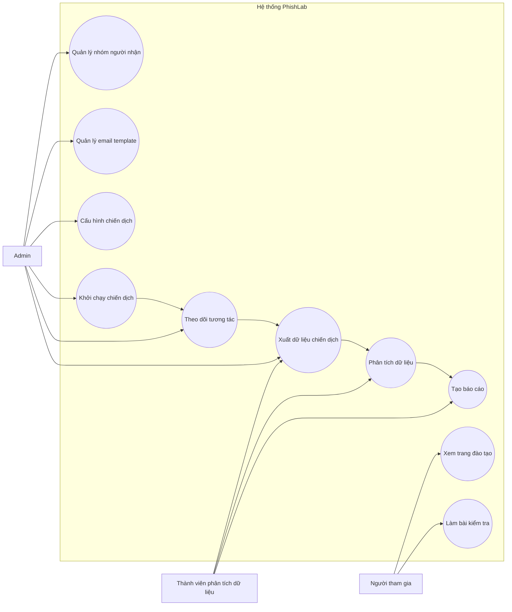
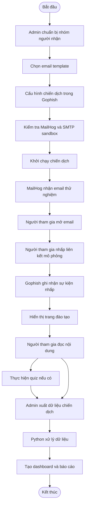

# PHISHLAB
# TÀI LIỆU USE CASE
**Tên đề tài:** PhishLab – Hệ thống mô phỏng và đánh giá nhận thức người dùng trước các cuộc tấn công Phishing
**Tài liệu:** Use Case Specification
**Phiên bản:** 1.0
**Phụ trách:** Member 01 – Project Lead / Analyst
---
## 1. Giới thiệu
### 1.1. Mục đích
Tài liệu mô tả các tác nhân, chức năng và luồng tương tác chính của hệ thống PhishLab.
Use Case được xây dựng dựa trên các yêu cầu trong `requirements.md`, nhằm giúp các thành viên hiểu cách hệ thống hoạt động và xác định trách nhiệm triển khai, kiểm thử từng chức năng.
### 1.2. Phạm vi
Use Case bao gồm các hoạt động:
- Quản lý nhóm người tham gia thử nghiệm.
- Quản lý email template.
- Tạo và cấu hình chiến dịch mô phỏng.
- Gửi email trong môi trường SMTP sandbox.
- Theo dõi các sự kiện mở email và nhấp liên kết.
- Hiển thị trang đào tạo nhận diện phishing.
- Thực hiện bài kiểm tra nhận thức nếu chức năng quiz được triển khai.
- Xuất dữ liệu và tạo báo cáo chiến dịch.
Hệ thống sử dụng Gophish để quản lý chiến dịch và tracking, MailHog làm SMTP sandbox, các thành phần HTML/CSS/JavaScript để xây dựng nội dung đào tạo và Python để phân tích dữ liệu.
## 2. Tác nhân hệ thống
### 2.1. Admin
**Mô tả:** Người quản lý chiến dịch mô phỏng thông qua Gophish.
**Quyền và hoạt động:**
- Tạo và quản lý nhóm người nhận.
- Chọn email template.
- Chọn landing page.
- Cấu hình sending profile.
- Tạo và khởi chạy chiến dịch.
- Theo dõi kết quả chiến dịch.
- Xuất dữ liệu phục vụ phân tích.
**Thành viên phụ trách chính:** Member 02.
### 2.2. Người tham gia
**Mô tả:** Người nhận email mô phỏng trong chiến dịch.
**Hoạt động:**
- Nhận email trong hộp thư thử nghiệm.
- Mở email.
- Nhấp vào liên kết mô phỏng.
- Xem trang hướng dẫn nhận diện phishing.
- Hoàn thành bài kiểm tra nếu quiz được triển khai.
**Thành viên phụ trách giao diện đào tạo:** Member 03.
### 2.3. Thành viên phân tích dữ liệu
**Mô tả:** Người xử lý dữ liệu chiến dịch và tổng hợp báo cáo.
**Hoạt động:**
- Nhận file kết quả xuất từ Gophish.
- Làm sạch và xử lý dữ liệu.
- Tính toán các chỉ số chiến dịch.
- Tạo biểu đồ và báo cáo.
- Đối chiếu số liệu báo cáo với dữ liệu nguồn.
**Thành viên phụ trách chính:** Member 04.
### 2.4. Các hệ thống hỗ trợ
| Thành phần | Vai trò |
|---|---|
| Gophish | Quản lý template, nhóm người nhận, campaign, landing page và tracking |
| MailHog | Nhận email thử nghiệm thông qua SMTP sandbox |
| Training Portal | Hiển thị nội dung đào tạo và quiz |
| Python Analytics | Xử lý dữ liệu và tạo báo cáo |
Các thành phần trên là hệ thống hỗ trợ trong kiến trúc, không phải người dùng trực tiếp của hệ thống.
## 3. Sơ đồ Use Case tổng quan

## 4. Danh sách Use Case
| Mã | Tên Use Case | Tác nhân chính | Mức độ |
|---|---|---|---|
| UC01 | Quản lý nhóm người nhận | Admin | Bắt buộc |
| UC02 | Quản lý email template | Admin | Bắt buộc |
| UC03 | Cấu hình chiến dịch | Admin | Bắt buộc |
| UC04 | Khởi chạy chiến dịch | Admin | Bắt buộc |
| UC05 | Theo dõi tương tác email | Admin | Bắt buộc |
| UC06 | Xem trang đào tạo | Người tham gia | Bắt buộc |
| UC07 | Thực hiện bài kiểm tra | Người tham gia | Nên có |
| UC08 | Xuất dữ liệu chiến dịch | Admin / Thành viên phân tích | Bắt buộc |
| UC09 | Phân tích dữ liệu | Thành viên phân tích | Bắt buộc |
| UC10 | Tạo báo cáo | Thành viên phân tích | Bắt buộc |
## 5. Đặc tả chi tiết Use Case
### UC01 – Quản lý nhóm người nhận
**Tác nhân chính:** Admin
**Mục tiêu:** Tạo danh sách người tham gia phục vụ chiến dịch mô phỏng.
**Điều kiện tiên quyết:**
- Gophish đã được cài đặt và khởi động.
- Admin có quyền truy cập giao diện quản trị.
- Có file CSV hoặc dữ liệu người nhận thử nghiệm.
**Luồng chính:**
1. Admin truy cập Gophish.
2. Chọn mục Users & Groups.
3. Chọn tạo nhóm mới.
4. Nhập tên nhóm.
5. Thêm người nhận thủ công hoặc import file CSV.
6. Kiểm tra dữ liệu đã nhập.
7. Lưu nhóm người nhận.
8. Hệ thống hiển thị nhóm vừa tạo.
**Luồng ngoại lệ:**
- File CSV không đúng định dạng: Admin kiểm tra và sửa lại file.
- Dữ liệu người nhận thiếu trường cần thiết: Admin bổ sung dữ liệu.
- Nhóm không được lưu thành công: Admin kiểm tra thông báo lỗi và thực hiện lại.
**Kết quả sau khi hoàn thành:**
Nhóm người nhận thử nghiệm được lưu trong Gophish và có thể được chọn khi cấu hình chiến dịch.
**Thành viên phụ trách:** Member 02.
### UC02 – Quản lý email template
**Tác nhân chính:** Admin
**Mục tiêu:** Lựa chọn và quản lý các mẫu email mô phỏng.
**Điều kiện tiên quyết:**
- Gophish hoạt động bình thường.
- Các email template đã được chuẩn bị.
**Luồng chính:**
1. Admin truy cập mục Email Templates.
2. Chọn tạo template mới hoặc chọn template đã có.
3. Nhập tên template.
4. Nhập tiêu đề email và nội dung HTML.
5. Kiểm tra nội dung email.
6. Lưu template.
7. Admin có thể chọn template này khi tạo chiến dịch.
**Luồng ngoại lệ:**
- Nội dung HTML không hiển thị đúng: Thành viên phụ trách template kiểm tra lại mã HTML.
- Template chưa được lưu: Admin kiểm tra thông báo và lưu lại.
**Kết quả sau khi hoàn thành:**
Email template được lưu trong Gophish và sẵn sàng sử dụng trong chiến dịch.
**Thành viên phụ trách nội dung:** Member 03.
### UC03 – Cấu hình chiến dịch
**Tác nhân chính:** Admin
**Mục tiêu:** Chuẩn bị các thành phần cần thiết cho một chiến dịch mô phỏng.
**Điều kiện tiên quyết:**
- Có nhóm người nhận thử nghiệm.
- Có email template.
- Có landing page đào tạo.
- Sending profile đã được cấu hình và kiểm tra.
- Môi trường lab đã sẵn sàng.
**Luồng chính:**
1. Admin truy cập mục Campaigns.
2. Chọn New Campaign.
3. Nhập tên chiến dịch.
4. Chọn email template.
5. Chọn landing page đào tạo.
6. Chọn URL của máy chủ lab.
7. Chọn sending profile.
8. Chọn nhóm người nhận.
9. Kiểm tra lại các thông tin cấu hình.
10. Lưu hoặc chuẩn bị khởi chạy chiến dịch.
**Luồng ngoại lệ:**
- Chưa có email template: Admin quay lại tạo hoặc chọn template.
- Chưa có nhóm người nhận: Admin tạo nhóm người nhận trước.
- Sending profile không kết nối được SMTP sandbox: Admin phối hợp với Member 02 để kiểm tra MailHog và cấu hình SMTP.
- URL landing page không truy cập được: Kiểm tra cấu hình mạng và địa chỉ máy chủ lab.
**Kết quả sau khi hoàn thành:**
Các thành phần của chiến dịch được cấu hình đầy đủ trong Gophish.
**Thành viên phụ trách:** Member 02.
### UC04 – Khởi chạy chiến dịch
**Tác nhân chính:** Admin
**Hệ thống hỗ trợ:** Gophish, MailHog
**Mục tiêu:** Gửi email mô phỏng đến nhóm người nhận thử nghiệm trong môi trường lab.
**Điều kiện tiên quyết:**
- Chiến dịch đã được cấu hình.
- MailHog đang hoạt động.
- Sending profile kết nối đúng đến SMTP sandbox.
- Nhóm người nhận sử dụng dữ liệu giả lập.
- Phạm vi thử nghiệm đã được phê duyệt.
**Luồng chính:**
1. Admin kiểm tra lại chiến dịch.
2. Admin xác nhận nhóm người nhận thử nghiệm.
3. Admin khởi chạy chiến dịch.
4. Gophish gửi email qua SMTP sandbox.
5. MailHog nhận email.
6. Email xuất hiện trong giao diện hộp thư thử nghiệm.
7. Admin kiểm tra email đã được nhận.
**Luồng ngoại lệ:**
- MailHog không hoạt động: Kiểm tra trạng thái dịch vụ.
- Gửi email thất bại: Kiểm tra sending profile và kết nối SMTP.
- Email không xuất hiện trong MailHog: Kiểm tra log và cấu hình người nhận.
**Kết quả sau khi hoàn thành:**
Email mô phỏng được chuyển vào MailHog để phục vụ hoạt động kiểm thử.
**Thành viên phụ trách:** Member 02.
### UC05 – Theo dõi tương tác email
**Tác nhân chính:** Admin
**Hệ thống hỗ trợ:** Gophish
**Mục tiêu:** Quan sát các sự kiện tương tác của người tham gia trong chiến dịch.
**Điều kiện tiên quyết:**
- Chiến dịch đã được khởi chạy.
- Email thử nghiệm đã được gửi.
- Các cơ chế tracking được cấu hình.
**Luồng chính:**
1. Admin truy cập chiến dịch trong Gophish.
2. Admin xem kết quả tracking.
3. Hệ thống hiển thị trạng thái gửi email.
4. Hệ thống ghi nhận sự kiện mở email khi tracking hoạt động.
5. Hệ thống ghi nhận sự kiện nhấp vào liên kết mô phỏng.
6. Admin theo dõi kết quả tương tác.
**Luồng ngoại lệ:**
- Không ghi nhận được lượt mở: Kiểm tra cơ chế tracking và lưu ý rằng email client có thể chặn hoặc tự động tải ảnh tracking.
- Không ghi nhận được lượt nhấp: Kiểm tra URL mô phỏng và cấu hình chiến dịch.
- Kết quả chưa cập nhật: Kiểm tra trạng thái chiến dịch và dữ liệu sự kiện.
**Kết quả sau khi hoàn thành:**
Gophish có dữ liệu tracking để phục vụ phân tích chiến dịch.
**Thành viên phụ trách:** Member 02.
### UC06 – Xem trang đào tạo
**Tác nhân chính:** Người tham gia
**Hệ thống hỗ trợ:** Gophish Landing Page / Training Portal
**Mục tiêu:** Giúp người tham gia nhận biết các dấu hiệu của email phishing.
**Điều kiện tiên quyết:**
- Người tham gia nhận được email thử nghiệm.
- Liên kết mô phỏng có thể truy cập trong môi trường lab.
- Trang đào tạo đã được triển khai.
**Luồng chính:**
1. Người tham gia mở email thử nghiệm.
2. Người tham gia nhấp vào liên kết mô phỏng.
3. Gophish ghi nhận sự kiện nhấp khi tracking hoạt động.
4. Hệ thống chuyển người tham gia đến trang đào tạo.
5. Trang đào tạo hiển thị thông báo đây là hoạt động mô phỏng.
6. Người tham gia đọc các dấu hiệu nhận diện phishing.
7. Người tham gia xem các khuyến nghị phòng tránh.
**Luồng ngoại lệ:**
- Trang đào tạo không truy cập được: Kiểm tra URL và trạng thái máy chủ.
- Nội dung không hiển thị đúng: Kiểm tra HTML, CSS và tài nguyên liên quan.
**Kết quả sau khi hoàn thành:**
Người tham gia xem được nội dung đào tạo nhận diện phishing.
**Thành viên phụ trách:** Member 03.
**Yêu cầu an toàn:** Trang đào tạo không có biểu mẫu đăng nhập hoặc trường nhập mật khẩu, OTP. Không thu thập thông tin xác thực.
### UC07 – Thực hiện bài kiểm tra nhận thức
**Tác nhân chính:** Người tham gia
**Mức độ:** Nên có
**Hệ thống hỗ trợ:** Training Portal
**Mục tiêu:** Đánh giá khả năng nhận diện phishing sau khi người tham gia đọc nội dung đào tạo.
**Điều kiện tiên quyết:**
- Người tham gia đã truy cập trang đào tạo.
- Quiz đã được triển khai.
**Luồng chính:**
1. Người tham gia truy cập phần quiz.
2. Hệ thống hiển thị câu hỏi.
3. Người tham gia chọn câu trả lời.
4. Người tham gia hoàn thành bài kiểm tra.
5. Hệ thống tính điểm.
6. Hệ thống hiển thị kết quả phù hợp.
7. Điểm số tổng hợp được lưu để phục vụ phân tích.
**Luồng ngoại lệ:**
- Người tham gia chưa hoàn thành bài kiểm tra: Hệ thống thông báo các câu hỏi chưa trả lời.
- Có lỗi khi tính điểm: Kiểm tra logic xử lý quiz.
**Kết quả sau khi hoàn thành:**
Điểm số bài kiểm tra được tổng hợp phục vụ đánh giá sau đào tạo.
**Thành viên phụ trách:** Member 03 và Member 04.
**Yêu cầu bảo vệ dữ liệu:** Chỉ lưu điểm số tổng hợp; không lưu câu trả lời gắn với danh tính hoặc email cá nhân.
### UC08 – Xuất dữ liệu chiến dịch
**Tác nhân chính:** Admin / Thành viên phân tích dữ liệu
**Hệ thống hỗ trợ:** Gophish
**Mục tiêu:** Lấy dữ liệu kết quả chiến dịch để phân tích.
**Điều kiện tiên quyết:**
- Chiến dịch đã có dữ liệu tương tác.
- Người thực hiện có quyền truy cập kết quả chiến dịch.
**Luồng chính:**
1. Admin hoặc thành viên phân tích mở kết quả chiến dịch.
2. Chọn chức năng xuất dữ liệu.
3. Xuất kết quả ở định dạng CSV.
4. Kiểm tra file vừa xuất.
5. Chuyển file cho bộ phận phân tích dữ liệu.
**Luồng ngoại lệ:**
- Không có dữ liệu để xuất: Kiểm tra trạng thái chiến dịch.
- File CSV không hợp lệ: Kiểm tra lại dữ liệu xuất và định dạng file.
**Kết quả sau khi hoàn thành:**
File kết quả chiến dịch sẵn sàng cho quá trình xử lý bằng Python.
**Thành viên phụ trách:** Member 02 và Member 04.
### UC09 – Phân tích dữ liệu chiến dịch
**Tác nhân chính:** Thành viên phân tích dữ liệu
**Hệ thống hỗ trợ:** Python, Pandas
**Mục tiêu:** Làm sạch và tổng hợp dữ liệu chiến dịch.
**Điều kiện tiên quyết:**
- Đã có file CSV kết quả từ Gophish.
- Dữ liệu điểm quiz tổng hợp đã sẵn sàng nếu sử dụng chức năng quiz.
**Luồng chính:**
1. Thành viên phân tích đọc dữ liệu nguồn.
2. Kiểm tra cấu trúc và tính hợp lệ của dữ liệu.
3. Làm sạch dữ liệu.
4. Tổng hợp trạng thái gửi email, mở email và nhấp liên kết.
5. Tính toán các chỉ số chiến dịch.
6. Tổng hợp dữ liệu hoàn thành đào tạo và điểm quiz nếu có.
7. Chuẩn bị dữ liệu đầu ra cho dashboard và báo cáo.
**Luồng ngoại lệ:**
- Thiếu trường dữ liệu: Kiểm tra file nguồn.
- Dữ liệu trùng lặp hoặc không hợp lệ: Làm sạch trước khi tổng hợp.
- Dữ liệu quiz không có: Chỉ tạo báo cáo các chỉ số chiến dịch hiện có, không tự tạo điểm số.
**Kết quả sau khi hoàn thành:**
Dữ liệu chiến dịch đã được xử lý và sẵn sàng trực quan hóa.
**Thành viên phụ trách:** Member 04.
### UC10 – Tạo báo cáo chiến dịch
**Tác nhân chính:** Thành viên phân tích dữ liệu
**Hệ thống hỗ trợ:** Python, Excel hoặc Dashboard
**Mục tiêu:** Trình bày kết quả chiến dịch dưới dạng báo cáo dễ hiểu.
**Điều kiện tiên quyết:**
- Dữ liệu đã được xử lý.
- Các chỉ số chiến dịch đã được tính toán.
**Luồng chính:**
1. Thành viên phân tích lấy dữ liệu đã xử lý.
2. Tạo bảng tổng hợp.
3. Tạo biểu đồ thống kê.
4. Hiển thị các chỉ số chiến dịch.
5. So sánh kết quả giữa các kịch bản nếu dữ liệu cho phép.
6. Đưa ra nhận xét và khuyến nghị.
7. Xuất báo cáo.
**Luồng ngoại lệ:**
- Không đủ dữ liệu so sánh: Chỉ trình bày các chỉ số có sẵn.
- Biểu đồ không khớp dữ liệu nguồn: Kiểm tra lại quá trình xử lý.
- Thiếu dữ liệu thực nghiệm: Ghi rõ phần chưa có kết quả, không thay bằng số liệu minh họa.
**Kết quả sau khi hoàn thành:**
Có báo cáo thống kê từ dữ liệu chiến dịch thực tế.
**Thành viên phụ trách:** Member 04.
## 6. Luồng hoạt động tổng thể

## 7. Quan hệ giữa Use Case và yêu cầu chức năng
| Use Case | Yêu cầu liên quan |
|---|---|
| UC01 – Quản lý nhóm người nhận | FR02 |
| UC02 – Quản lý email template | FR01 |
| UC03 – Cấu hình chiến dịch | FR03 |
| UC04 – Khởi chạy chiến dịch | FR03 |
| UC05 – Theo dõi tương tác email | FR05 |
| UC06 – Xem trang đào tạo | FR04, FR07 |
| UC07 – Thực hiện bài kiểm tra | FR08 |
| UC08 – Xuất dữ liệu chiến dịch | FR06 |
| UC09 – Phân tích dữ liệu chiến dịch | FR06 |
| UC10 – Tạo báo cáo chiến dịch | FR06, FR08 |
FR09 – Phân quyền quản trị là chức năng mở rộng, chưa đưa vào luồng Use Case chính của MVP.
## 8. Quy tắc và giới hạn an toàn
- Chỉ sử dụng hệ thống trong môi trường lab hoặc mạng nội bộ đã được phê duyệt.
- Dữ liệu người nhận sử dụng trong demo phải là dữ liệu giả lập.
- Không thu thập mật khẩu, OTP, cookie hoặc session token.
- Không tạo biểu mẫu đăng nhập trên trang đào tạo.
- Gophish phải đặt Capture Submitted Data = OFF và Capture Passwords = OFF.
- Không triển khai credential harvester hoặc phishing reverse proxy.
- Điểm quiz chỉ được lưu ở dạng tổng hợp, không gắn câu trả lời với danh tính người tham gia.
- MailHog được sử dụng làm SMTP sandbox để giữ email thử nghiệm trong môi trường lab.
## 9. Liên kết tài liệu
- `requirements.md` – Đặc tả yêu cầu hệ thống.
- `architecture.md` – Kiến trúc tổng thể và luồng dữ liệu.
- `member01-plan-review.md` – Kế hoạch và ghi nhận review của Member 01.
---
**Phụ trách:** Member 01 – Project Lead / Analyst